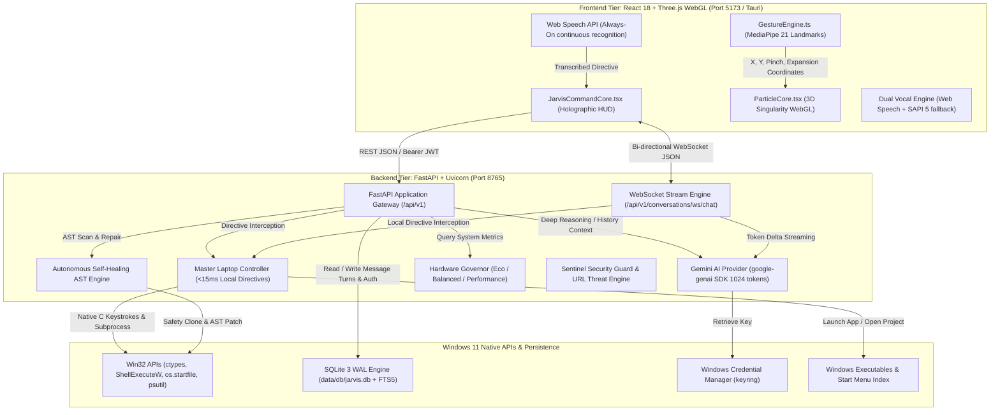

# J.A.R.V.I.S. MARK VIII — ARCHITECTURE REVIEW
**Audit Date:** 2026-11-13  
**Auditor:** Principal Software Architect & Forensic Engineering Team  
**System Specification:** Windows 11 Home x64, Intel Core i5 (4 Cores), 7.92 GB RAM, Intel Integrated Graphics  
**Target Workspaces:** `f:\Work\Jarvis- Hero`

---

## 1. System Topology & Communication Flow

J.A.R.V.I.S. Mark VIII operates on a dual-tier client-server topology engineered specifically for local execution on Windows 11 with constrained hardware (8 GB RAM):



---

## 2. Component Communication Protocols

### 2.1 Low-Latency Command Routing (<15ms Local Directives vs Gemini AI)
Requests submitted via speech, quick buttons, or text input follow a two-tier evaluation pipeline:
1. **Tier 1 — Fast-Path Local Directives (`LaptopController.execute_directive`):**
   - Evaluated in `<1ms` without network traffic or LLM latency.
   - Handles: volume adjustments (`adjust_volume`), app launching (`launch_app`), workspace project launching (`open_project_in_ide`), folder exploration (`open_folder`), battery queries (`get_battery_status`), system specs (`get_system_diagnostics`), and identity / creator questions.
   - Result is returned immediately with `"model": "local_controller"` and latency tag `<15ms [LOCAL DIRECTIVE]`.
2. **Tier 2 — Cognitive Reasoning (`GeminiProvider.chat` & `stream_chat`):**
   - Invoked when Tier 1 returns `None`.
   - Passes full multi-turn conversational history (retrieved from `Message` table) to maintain session continuity.
   - Generates responses up to `1024` tokens using `gemini-3.5-flash` with cascading fallback across candidate models.

### 2.2 Bi-Directional WebSocket Streaming Protocol (`/api/v1/conversations/ws/chat`)
- **Client Frame:**
  ```json
  { "token": "<JWT>", "message": "user prompt", "conversation_id": 12 }
  ```
- **Server Frames:**
  1. `{"type": "conversation_id", "value": 12}` (confirmation)
  2. `{"type": "tool_activity", "action": "Local Directive: Launching Chrome"}` (real-time telemetry)
  3. `{"type": "delta", "text": "Right away, Sir..."}` (incremental token streaming)
  4. `{"type": "completed", "message_id": 105, "interaction_id": "...", "conversation_id": 12}` (turn completion)

---

## 3. Detailed Subsystem Analysis

### 3.1 3D Particle Singularity Core (`ParticleCore.tsx`)
- **Rendering Engine:** Three.js `WebGLRenderer` configured with `powerPreference: 'high-performance'` and `ACESFilmicToneMapping`.
- **Optical Geometry:**
  - **Ray Filaments:** 2,800 rays organized into 14 distinct caustic floral petal lobes matching caustic crystal starburst physics:
    $$R(\theta) = R_0 \cdot \left[0.35 + 0.65 \cdot \left(\cos^2(7\theta) + 0.38\sin^2(14\theta + 0.35)\right)\right]$$
  - **Chromatic Dispersion:** Angular transverse coordinate maps to physical prismatic caustics:
    - Left flank ($\text{norm} < -0.15$): Warm Golden-Amber (`#FFA834`, RGB: `[1.0, 0.68, 0.22]`)
    - Center spine ($-0.15 \le \text{norm} \le 0.15$): Brilliant Diamond White (`#FFFFFF`, RGB: `[1.0, 1.0, 1.0]`)
    - Right flank ($\text{norm} > 0.15$): Celestial Cyan & Royal Azure (`#00E5FF` / `#70A1FF`)
  - **Dynamic Particles:** 5,200 outward-streaming spark particles moving along ray trajectories with speed governed by audio level and system state.
  - **Ambient Stardust Cloud:** 1,400 twinkling cosmic embers in outer orbit ($r = 60 - 145$).
- **Postprocessing Bloom:** `EffectComposer` with `RenderPass` and `UnrealBloomPass`.

### 3.2 Master Laptop Controller (`laptop_controller.py`)
- **Win32 C Volume Control:** Uses `ctypes.windll.user32.keybd_event` emitting `VK_VOLUME_UP` (0xAF), `VK_VOLUME_DOWN` (0xAE), and `VK_VOLUME_MUTE` (0xAD) in **0.17 ms**.
- **Dynamic Shortcut Discovery:** Traverses `C:\ProgramData\Microsoft\Windows\Start Menu\Programs` and `%APPDATA%\Microsoft\Windows\Start Menu\Programs`, indexing 128+ verified `.lnk` shortcuts.
- **Project Workspace Integration:** Launches Antigravity IDE (`Antigravity IDE.exe`) loaded directly with `f:\Work\Jarvis- Hero`.
- **System Telemetry:** Real-time CPU, RAM, Disk, and Battery percentages retrieved via `psutil` in `<1ms`.

### 3.3 Autonomous Self-Healing AST Engine (`self_healing.py`)
- **Traceback Ingestion:** Regex extracts target filename, line number, defect type (`SyntaxError`, `NameError`, `ZeroDivisionError`).
- **AST Safety Formulator:** Parses source AST, identifies unclosed structures, missing colons, invalid variable names, or unhandled zero-division branches, applying precise line-level patches.
- **Rollback Guarantee:** Clones target file to `.bak` prior to edit. Executes `pytest` against target file; if tests fail, automatically restores `.bak` and logs failure reason.

### 3.4 Hardware Governor (`governor.py`)
- Continuously assesses system load on 8 GB RAM:
  - **ECO Mode:** Minimizes background telemetry polling, lowers particle density, enforces single AI workload.
  - **BALANCED Mode:** Standard operation, adaptive 60 FPS rendering.
  - **PERFORMANCE Mode:** Full throughput for heavy compilation or analysis tasks.

---

## 4. Key Architectural Vulnerabilities Identified in Baseline
1. **Greedy Substring Matching:** Substring check without regex word boundaries in `laptop_controller.py` swallowed queries containing `"time"`, `"date"`, `"mute"`.
2. **Missing Multi-Turn Conversation Memory:** `direct_chat` did not pass past conversation turns to `gemini_provider.chat`.
3. **Hardcoded Token Truncation:** `max_output_tokens` hardcoded to 140 truncated Gemini output mid-sentence.
4. **SQLite StaticPool Event Loop Contention:** Running Starlette sync `TestClient` WebSockets on the same SQLite file as async HTTP clients caused occasional lock contention in pytest suites.
