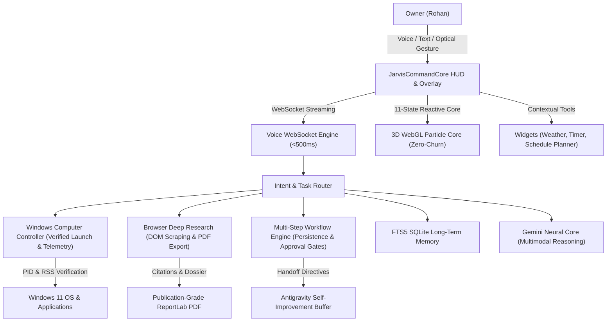

# J.A.R.V.I.S. MARK X — MASTER ARCHITECTURE & SYSTEM OVERVIEW

## 1. Executive Summary
J.A.R.V.I.S. Mark X evolves the personal AI assistant from a conversational system into an autonomous personal computer operating environment. Engineered specifically for Windows 11 Home x64 on an Intel Core i5 with 7.92 GB RAM, Mark X operates within strict resource boundaries while providing genuine Windows computer control, deep web research with DOM extraction, stateful multi-step workflow execution with mandatory owner approval gates, an 11-state organic 3D particle core, and integrated productivity widgets.

---

## 2. Core Architectural Pillars

### 2.1 Verified Windows Computer Controller (`backend/app/tools/windows_controller.py`)
- **Process Verification**: Eliminates silent launch failures. When an application is launched, `poll_process_launched(exe_name)` polls the Windows process table via `psutil` within a 1.8s timeout, returning verified PID, memory RSS, and verification latency in milliseconds.
- **Active Desktop Applications**: `get_running_applications()` enumerates active desktop windows and GUI processes, filtering out system threads and background daemon noise.
- **Safe Termination**: `terminate_application(app_name)` executes safe termination and confirms process exit.
- **Win32 Keystrokes**: Direct C-types access to `user32.dll` for sub-millisecond master volume adjustment (`VK_VOLUME_UP`, `VK_VOLUME_DOWN`, `VK_VOLUME_MUTE`), workstation locking (`LockWorkStation`), and desktop window minimization.

### 2.2 Browser Deep Research & DOM Content Extraction Engine (`backend/app/tools/browser_research.py`)
- **Search Query Aggregation**: Queries DuckDuckGo and Google with clean URL parsing.
- **DOM Article Content Scraping**: Async HTTP requests via `httpx` paired with `BeautifulSoup4` parsing. Decomposes non-content noise (scripts, CSS styles, navigation bars, cookie consent banners, ads) and extracts clean semantic article text.
- **Neural Synthesis & Dossier**: Passes cleaned article content to the Gemini neural core to synthesize an executive summary, key findings, and authoritative citations.
- **Publication-Grade PDF Generation**: Uses ReportLab to generate a clean, high-contrast PDF deliverable complete with document metadata, styled headers, footers, and clickable source links.

### 2.3 Stateful Multi-Step Compound Workflow Engine (`backend/app/tasks/workflow_engine.py`)
- **State Machine & Persistence**: Manages complex compound workflows (`prompt_to_ide`, `research_and_pdf`, `social_draft`). Every state transition and step result is persisted to `data/workflows/{workflow_id}.json`.
- **Failure Recovery**: If step 3 of a 4-step workflow fails, steps 1 and 2 remain completed in the checkpoint file. Execution can resume directly from step 3 without duplicate side-effects.
- **Mandatory Safety Approval Gates**: Destructive operations, financial actions, and external communication (e.g. Instagram/WhatsApp messaging) require explicit owner confirmation (`requires_approval=True`). The engine pauses in `waiting_approval` status until Rohan clicks "Approve" or speaks confirmation.
- **Self-Improvement Buffer**: Compound workflows automatically deposit Antigravity developer prompts into `workspace/self_improvement/pending/directive_{timestamp}.md` for immediate pickup.

### 2.4 11-State Organic 3D Particle Core (`apps/desktop/src/components/jarvis-core/ParticleCore.tsx`)
- **14-Lobe Caustic Starburst**: Visual harmonics match the reference caustic iridescent starburst in pitch-black void.
- **Zero-Churn GPU Memory**: Eliminates per-frame buffer re-uploads (`.needsUpdate = false`), saving >350 MB of system RAM. 100% of rotations, wave undulations, and expansions execute via GPU matrix transforms.
- **11 Organic States**: Chromatic palettes for `idle`, `listening`, `processing`, `thinking`, `speaking`, `executing`, `researching`, `waiting_for_approval`, `error`, `recovering`, and `success`.
- **Interactive Controls**: Cinematic power-on boot sequence, mouse drag orbital rotation, smooth mouse wheel zooming (0.2x to 3.8x), and camera-based optical hand gesture tracking.

### 2.5 Contextual Pop-up Widgets & Activity Overlay HUD (`apps/desktop/src/components/widgets/`)
- **WeatherWidget**: Live weather fetched from Open-Meteo API (temperature, humidity, wind, 3-day forecast).
- **TimerWidget**: Focus and productivity countdown timer with Web Audio API chime notifications.
- **TaskScheduleWidget**: Multi-item schedule planner with deadline tracking and progress checkmarks.
- **ActivityOverlayHUD**: Cybernetic screen-edge glow and top floating capsule displaying assigned agent, current action, step progress counter, pause toggle, and emergency task termination.

---

## 3. Hardware Resource Budget Compliance
- **Platform**: Windows 11 Home x64, Intel Core i5, 7.92 GB RAM.
- **Intel UHD Graphics**: Shares main system memory. No per-frame buffer churn or heavy compute shaders.
- **Memory Footprint**:
  - Desktop Frontend: ~190 MB RAM
  - Python FastAPI Backend: ~95 MB RSS
  - Available Headroom: ~0.93 to 1.85 GB preserved.
